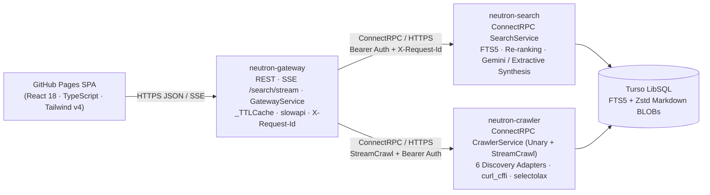

# Neutron v3.0: Distributed Web Search, Streaming Crawler & Cited Research Engine

A **zero-telemetry** web search engine, real-time streaming crawler, and grounded research API built with **React + TypeScript**, **FastAPI + ConnectRPC/gRPC (Protobuf)**, **Turso (LibSQL FTS5 + Zstd)**, and optional **Gemini 2.5 Flash** synthesis—deployed for **\$0/month** on **Render Free Web Services + GitHub Pages**.

---

## Architecture at a Glance



For full component, sequence, ranking, database schema, security, and cold-start details, see **[docs/ARCHITECTURE.md](docs/ARCHITECTURE.md)**.

---

## Key Features (Current Stack)

- **3-Microservice ConnectRPC/gRPC Split**: Public edge gateway (`services/gateway`) talks over HTTPS ConnectRPC/Protobuf (`proto/neutron/v1/neutron.proto` → `neutron_rpc/`) to `services/search` and `services/crawler` using shared constant-time Bearer auth (`InternalAuthInterceptor` over unary and streaming RPCs).
- **Stemmed Quorum FTS5 + Concept Re-Ranking**: Strips conversational filler (`purpose`, `main`, `overview`, etc.), expands regular morphological inflections (`joining` → `join` / `joins` / `joined`) with FTS5-safe explicit `AND` grouping, boosts authoritative references, and down-ranks generic template README boilerplate.
- **Cited Grounded Synthesis (Gemini Optional + Automatic Fallback)**: Uses `gemini-2.5-flash` over REST (`GEMINI_API_KEY` on `neutron-search`, `4.5s` timeout) when configured, falling back automatically to extractive cited synthesis (`[1]..[N]`) with clickable Reader citations (`/?doc=<url_hash>`).
- **Single-RPC Live Streaming (`StreamCrawl`)**: Streams real-time discovery metrics (`duckduckgo`, `wikipedia`, `hackernews`, `arxiv`, `github`, `reddit`) and parallel `curl_cffi` Chrome 124 fetches within a `< 5s` JIT deadline into SSE events (`cached_results`, `discovery_result`, `crawl_start`, `crawl_success`, `live_result`, `answer`, `done`).
- **Speed, Tracing & Zero-Tracking Privacy**: Bounded `_TTLCache` (`300s` searches, `30s` stats) with `?refresh=true` bypass, `X-Request-Id` end-to-end tracing + phase `timings`, `sessionStorage` UI cache + live `/trending` chips, `DOMPurify`-sanitized Markdown reader, zero cookies, and zero IP persistence ([PRIVACY.md](PRIVACY.md)).

---

## Active Repository Structure

```text
├── frontend/                   # React 18 + TypeScript + Vite SPA (GitHub Pages)
├── proto/neutron/v1/           # Protobuf contracts (SearchService, CrawlerService, GatewayService)
├── neutron_rpc/neutron/v1/     # Generated ConnectRPC + Protobuf Python stubs (via scripts/gen_proto.py)
├── services/
│   ├── common/                 # Shared Pydantic config (Render URL fallback, TLS certifi) & RPC helpers
│   ├── gateway/                # Public Edge Gateway (REST + SSE + ConnectRPC + _TTLCache)
│   ├── search/                 # Search index query, re-ranking, reader lookup & Gemini/extractive synthesis
│   └── crawler/                # Parallel seed discovery, StreamCrawl RPC, curl_cffi fetcher & parser
├── spaces/crawler/             # Core search/crawler library modules imported by services/*
├── migrations/
│   └── 03_turso_fts5_schema.sql # Turso LibSQL schema (search_index, search_fts, page_payloads, etc.)
├── scripts/
│   ├── gen_proto.py            # Regenerate ConnectRPC/Protobuf Python stubs
│   ├── init_turso.py           # Initialize Turso FTS5 tables and triggers
│   └── refresh_stale.py        # Re-crawl oldest Turso rows using current parser
├── tests/
│   ├── test_core.py            # Parser, FTS5, ranking, Gemini synthesis, Bloom/SimHash & endpoint tests
│   └── test_microservices.py   # Live Uvicorn Search <-> Crawler <-> Gateway ConnectRPC & SSE tests
├── docs/
│   ├── ARCHITECTURE.md         # Detailed high-level system architecture
│   └── RENDER_DEPLOY.md        # Step-by-step Render + GitHub Pages setup
├── render.yaml                 # 3-service Render Free Blueprint
└── .github/workflows/          # CI tests/migration (ci_cd.yml) & GitHub Pages build (deploy_pages.yml)
```

---

## Gateway Public Endpoints

| Endpoint | Description |
| :--- | :--- |
| `GET /health` | Readiness probe + throttled downstream warm-up for `neutron-search` and `neutron-crawler` |
| `GET /stats` | Index counters (`pages_indexed`, `domains_covered`, `frontier_pending`, `payloads_stored`, `connected`) |
| `GET /trending` | Top recent hot topics from Turso |
| `GET /suggest?q=...` | Query autocomplete suggestions |
| `GET /search?q=...&mode=all&refresh=false` | Unified hybrid search JSON (`results`, `answer`, `timings`, `cache_hit`, `request_id`) |
| `GET /search/stream?q=...&mode=all&refresh=false` | Server-Sent Events (SSE) stream backed by `QueryIndex` + `CrawlerService.StreamCrawl` |
| `GET /api/research?q=...&include_markdown=true` | Developer & AI-Agent JSON endpoint returning grounded answer + full Markdown `sources` |
| `GET /doc/{url_hash}` | Decompressed Markdown article from `page_payloads` (`64-bit` string hash safe in JS) |

---

## Quick Start (Local Development)

### 1. Environment & Database Initialization
```bash
cp .env.example .env
# Generate a shared internal secret:
python -c "import secrets; print(secrets.token_urlsafe(32))"
# Set TURSO_DATABASE_URL, TURSO_AUTH_TOKEN, INTERNAL_API_KEY (and optional GEMINI_API_KEY) in .env

python scripts/init_turso.py
```

### 2. Regenerate Protobuf Stubs (After Editing `proto/`)
```bash
python scripts/gen_proto.py
```

### 3. Run Checks & Full Test Suite
```bash
pip install -r requirements.txt
python -m compileall -q spaces services scripts tests neutron_rpc
python -m ruff check --select E9,F63,F7,F82,F401 spaces services scripts tests
python -m unittest discover -s tests -v
```

### 4. Run the 3 Microservices + Frontend Locally
```bash
# Terminal 1 - Search Service
PORT=8081 uvicorn services.search.app:app --host 127.0.0.1 --port 8081

# Terminal 2 - Crawler Service
PORT=8082 uvicorn services.crawler.app:app --host 127.0.0.1 --port 8082

# Terminal 3 - Edge Gateway
SEARCH_SERVICE_URL=http://127.0.0.1:8081 CRAWLER_SERVICE_URL=http://127.0.0.1:8082 PORT=8080 \
  uvicorn services.gateway.app:app --host 127.0.0.1 --port 8080

# Terminal 4 - Frontend Dev Server
cd frontend && npm install && VITE_API_BASE_URL=http://127.0.0.1:8080 npm run dev
```

### 5. Refresh Older Indexed Turso Pages (Optional Maintenance)
```bash
python scripts/refresh_stale.py --older-than-days 14 --limit 25 --dry-run
python scripts/refresh_stale.py --older-than-days 14 --limit 25
```

---

## Deployment (Render Free + GitHub Pages)

- **Backend ([render.yaml](render.yaml))**: Deploy via Render **Blueprint** (`neutron-search`, `neutron-crawler`, `neutron-gateway`), setting `TURSO_DATABASE_URL` and `TURSO_AUTH_TOKEN` on `neutron-search` and `neutron-crawler`. To enable Gemini-powered summaries, set `GEMINI_API_KEY` on **`neutron-search` → Environment**. See [docs/RENDER_DEPLOY.md](docs/RENDER_DEPLOY.md) for walkthrough instructions.
- **Frontend ([.github/workflows/deploy_pages.yml](.github/workflows/deploy_pages.yml))**: Automatically builds `frontend/` on pushes to `main` and deploys to GitHub Pages pointing at `VITE_API_BASE_URL` (`https://neutron-gateway.onrender.com` by default, or repo variable `NEUTRON_API_URL`).
- **CI/CD ([.github/workflows/ci_cd.yml](.github/workflows/ci_cd.yml))**: Runs `compileall`, `ruff`, frontend `npm run build`, all unit/integration tests, and Turso schema migration on every push to `main`.

---

## Documentation

- [docs/Neutron_Architecture_Whitepaper.pdf](docs/Neutron_Architecture_Whitepaper.pdf) ([LaTeX Source](docs/latex/neutron_architecture.tex)) — Official System Design, HLD/LLD & Cloud Architecture Whitepaper
- [docs/ARCHITECTURE.md](docs/ARCHITECTURE.md) — Detailed High-Level System Architecture & Data Flows
- [docs/RENDER_DEPLOY.md](docs/RENDER_DEPLOY.md) — Render Free + GitHub Pages Deployment Guide
- [PRIVACY.md](PRIVACY.md) — Zero-Telemetry & Privacy Design
- [CONTRIBUTING.md](CONTRIBUTING.md) — Contribution Guidelines
