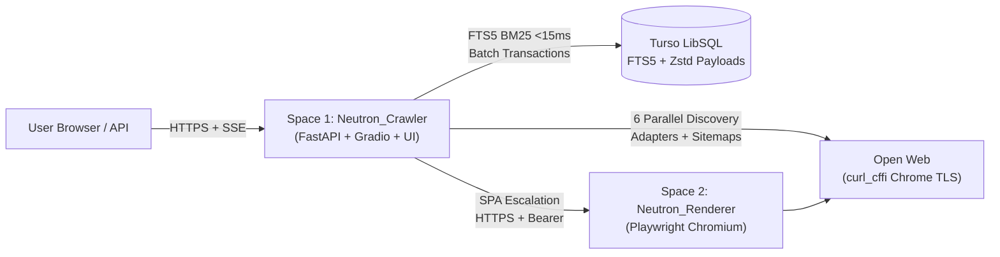

# Neutron v3.0 (Pulsar): Real-Time Decentralized Web Search & Research Engine

A cloud-native, **zero-telemetry** search engine, real-time web crawler, and AI-agent research API powered by **React + TypeScript**, **FastAPI**, **Turso (LibSQL FTS5)**, and **Playwright Chromium**, designed to run on **free-tier Hugging Face Spaces (\$0/month)**.

---

## Key Highlights

- **Instant Grounded Answer Synthesis**: Extracts top declarative passages across indexed & live-crawled Markdown articles (`page_payloads`) and displays a cited summary (`[1] [2]`) that opens directly in the clean Reader modal (`/?doc=<url_hash>`).
- **Fast-Fail Live Cascade (`< 5s` JIT Deadline)**: Runs tight live timeouts (`3.0s` HTTP, `1` retry, `4.5s` renderer escalation), caches WAF/anti-bot-blocked domains for 24h cooldown, and streams per-source discovery telemetry via SSE (`All Web`, `Encyclopedia`, `Papers`, `Code`, `Discussions`).
- **Developer & AI-Agent Research API (`/api/research`)**: Returns structured grounded answers, inline citations, focused excerpts, and optional full decompressed Markdown per source (`GET /api/research?q=...&include_markdown=true`).
- **High-Precision Search & Hardened Crawler Core**:
  - **O(1) URL Bloom Filter** (`mmh3` + `bitarray`) warmed from Turso at startup.
  - **SimHash Near-Duplicate Detection** (weighted unigrams + 2-gram shingles, Hamming distance <= 3).
  - **Stemmed + Quorum FTS5 Search**: Porter-stemmed BM25 (`4.0` title / `1.5` deep ~1,200-char prose snippet / `0.5` URL) without noisy 1-term `OR` dilution.
  - **Domain-Interleaved Frontier Queue**: SQLite `UPDATE ... RETURNING` lease lock with `domains.next_fetch_at` rotation + 5-minute lease recovery.
  - **WAF / Binary Gate & Politeness**: Rejects Cloudflare/Akamai interstitials and `.pdf`/binary seeds; respects `robots.txt` (`NeutronBot/3.0`) and `sitemap.xml` / `.xml.gz`.
- **Security & Privacy First**:
  - Zero cookies, zero IP persistence, zero click-tracking redirects ([PRIVACY.md](PRIVACY.md)).
  - Constant-time internal bearer verification (`hmac.compare_digest`), `slowapi` rate limiting, `str` 64-bit `url_hash` JSON serialization, `DOMPurify`-sanitized Markdown reader, and strict response security headers.

---

## Architecture Topology



---

## Performance & Design Comparison

| Capability | Neutron v3.0 | Traditional Search |
| :--- | :--- | :--- |
| **Indexed Query Latency** | `< 15ms` (Turso LibSQL FTS5) | `~50–150ms` |
| **Live Freshness** | Real-time SSE JIT crawl on sparse hits | Delayed batch re-index |
| **Crawl Transparency** | Full per-source & per-domain live trace | Opaque black box |
| **Telemetry / Tracking** | Zero cookies, zero IP storage | Extensive user profiling |
| **Infrastructure Cost** | `$0/month` (HF Spaces + Turso free tier) | Enterprise clusters |

---

## Quick Start

### 1. Database Initialization (Turso LibSQL)
```bash
cp .env.example .env
# Generate a secure internal secret:
python -c "import secrets; print(secrets.token_urlsafe(32))"
# Configure TURSO_DATABASE_URL, TURSO_AUTH_TOKEN, and INTERNAL_API_KEY in .env

python scripts/init_turso.py
```

### 2. Run Tests
```bash
pip install -r requirements.txt
python -m unittest discover -s tests -v
```

### 3. Run Locally
```bash
# Option A: Direct Unified Service
cd spaces/crawler
uvicorn app:app --host 0.0.0.0 --port 7860 --reload

# Option B: Full Multi-Service Docker Compose
docker compose up --build
```
Open **`http://localhost:7860`** in your browser.

---

## Hugging Face Spaces CI/CD Deployment

GitHub Actions (`.github/workflows/ci_cd.yml`) automatically runs on every push to `main`:
1. **`test`**: Syntax verification + `unittest` suite.
2. **`database-migration`**: Executes `scripts/init_turso.py` against Turso using `TURSO_DATABASE_URL` and `TURSO_AUTH_TOKEN`.
3. **`deploy-huggingface`**: Syncs `spaces/renderer` (`Neutron_Renderer`) and `spaces/crawler` (`Neutron_Crawler`) to Hugging Face Spaces via `HfApi` using `HF_TOKEN` and `HF_USERNAME`.

Configure these variables/secrets inside each Hugging Face Space's **Settings -> Variables and secrets**:
- `INTERNAL_API_KEY` (shared random secret between Crawler & Renderer)
- `TURSO_DATABASE_URL` & `TURSO_AUTH_TOKEN` (on `Neutron_Crawler`)
- `RENDERER_SERVICE_URL` (`https://<username>-neutron-renderer.hf.space` on `Neutron_Crawler`)

---

## Documentation
- [CHANGES.md](CHANGES.md) — Detailed v3.0 engineering & UI/UX design plan
- [PRIVACY.md](PRIVACY.md) — Privacy architecture & zero-telemetry guarantees
- [CONTRIBUTING.md](CONTRIBUTING.md) — Development setup & PR guidelines
