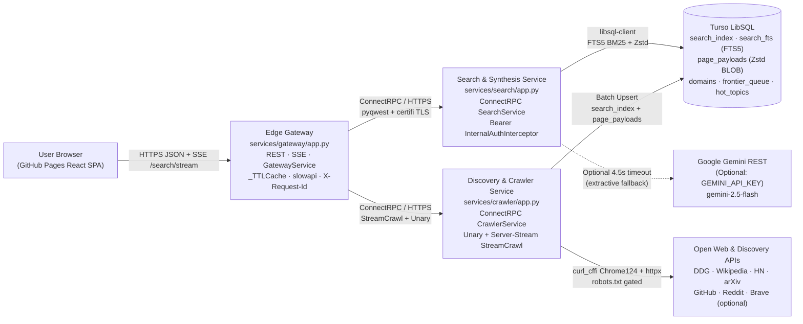
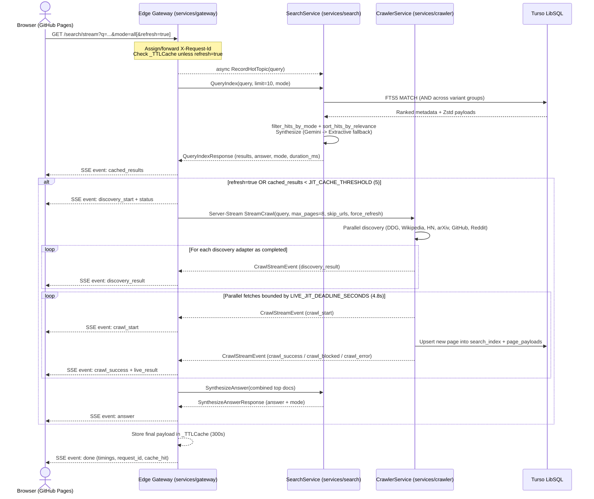

# Neutron High-Level System Architecture

This document describes the **current production architecture** of Neutron (`v3.0`), reflecting only the active code deployed across **GitHub Pages**, **Render Free Web Services**, and **Turso LibSQL**.

---

## 1. Architectural Overview

Neutron separates presentation, edge coordination, search/synthesis, and live web acquisition into loosely coupled components communicating over **HTTPS**, **Server-Sent Events (SSE)**, and **ConnectRPC / Protobuf (`proto3`)**:

- **Static Edge UI (`frontend/`)**: Single-page React + TypeScript application hosted on GitHub Pages.
- **Public Edge Gateway (`services/gateway/app.py`)**: Public REST/SSE/ConnectRPC coordinator handling rate limits, response caching (`_TTLCache`), request tracing (`X-Request-Id`), CORS, and service orchestration.
- **Search & Synthesis Service (`services/search/app.py`)**: Internal ConnectRPC service handling FTS5 retrieval, morphological/domain re-ranking, Zstd payload hydration, autocomplete/trending/stats queries, and cited answer synthesis (optional Gemini REST API with extractive fallback).
- **Discovery & Crawler Service (`services/crawler/app.py`)**: Internal ConnectRPC service handling parallel multi-source seed discovery, `robots.txt` validation, live HTTP fetching (`curl_cffi` Chrome TLS impersonation), HTML-to-Markdown parsing, SimHash/Bloom deduplication, and incremental Turso indexing.
- **Storage (`migrations/03_turso_fts5_schema.sql`)**: Single-database Turso (LibSQL/SQLite) store holding URL metadata, Porter-stemmed `FTS5` virtual tables, Zstd-compressed full-text Markdown blobs, frontier queues, domain politeness metadata, and hot-topic counts.

---

## 2. Active Codebase Map

| Layer | Active Files / Modules | Responsibility |
| :--- | :--- | :--- |
| **Protobuf Contract** | [proto/neutron/v1/neutron.proto](../proto/neutron/v1/neutron.proto), [scripts/gen_proto.py](../scripts/gen_proto.py), [neutron_rpc/neutron/v1/](../neutron_rpc/neutron/v1/neutron_connect.py) | `SearchService`, `CrawlerService`, and `GatewayService` service definitions & generated ConnectRPC stubs |
| **Shared Microservice Core** | [services/common/config.py](../services/common/config.py), [services/common/rpc.py](../services/common/rpc.py) | Pydantic settings (`GatewayServiceSettings`, `SearchServiceSettings`, `CrawlerServiceSettings`), Render URL fallback, auth interceptor (`MetadataInterceptor`), Protobuf↔Dict mappers |
| **Edge Gateway** | [services/gateway/app.py](../services/gateway/app.py) | Public REST + SSE endpoints, `_TTLCache`, rate limiter, `X-Request-Id` tracing, downstream `/health` warm-up |
| **Search & Synthesis** | [services/search/app.py](../services/search/app.py) | `SearchServiceImpl` RPC handlers (`QueryIndex`, `SynthesizeAnswer`, `GetDocument`, `Suggest`, `GetTrending`, `GetStats`, `RecordHotTopic`) |
| **Crawler Service** | [services/crawler/app.py](../services/crawler/app.py) | `CrawlerServiceImpl` RPC handlers (`DiscoverSeeds`, `CrawlUrl`, `DiscoverAndCrawl`, `StreamCrawl`), Bloom warmup, expired lease recovery |
| **Search & Crawler Engine** | [spaces/crawler/db_turso.py](../spaces/crawler/db_turso.py), [synthesis.py](../spaces/crawler/synthesis.py), [discovery.py](../spaces/crawler/discovery.py), [parser.py](../spaces/crawler/parser.py), [robots.py](../spaces/crawler/robots.py), [bloom.py](../spaces/crawler/bloom.py), [dedup.py](../spaces/crawler/dedup.py), [compression.py](../spaces/crawler/compression.py), [sitemap.py](../spaces/crawler/sitemap.py), [middleware.py](../spaces/crawler/middleware.py) | FTS5 queries, stemming/relevance scoring, Gemini + extractive synthesis, seed discovery, `selectolax` HTML→Markdown parser, Zstd compression, `xxHash64`, SimHash |
| **Frontend SPA** | [frontend/src/App.tsx](../frontend/src/App.tsx), `frontend/src/components/*`, [frontend/index.html](../frontend/index.html) | Search UI, SSE streaming client, `sessionStorage` query cache, live `/trending` chips, Markdown reader modal, stats drawer |
| **Database & Ops Scripts** | [migrations/03_turso_fts5_schema.sql](../migrations/03_turso_fts5_schema.sql), [scripts/init_turso.py](../scripts/init_turso.py), [scripts/refresh_stale.py](../scripts/refresh_stale.py), [render.yaml](../render.yaml) | Schema initialization, stale document re-crawl utility, Render Free 3-service Blueprint |

---

## 3. End-to-End Search & Streaming Data Flow

Neutron uses a **Cache-First + Just-In-Time (JIT) Live Crawl** cascade controlled by `JIT_CACHE_THRESHOLD` (`5`) and `LIVE_JIT_DEADLINE_SECONDS` (`4.8s`):

For non-streaming API clients (`GET /search` and `GET /api/research`), `Gateway` runs the equivalent flow synchronously via `CrawlerService.DiscoverAndCrawl` + `SearchService.SynthesizeAnswer` and returns JSON with `timings: {index_ms, crawl_ms, synth_ms, total_ms}`, `cache_hit`, and `request_id`.

---

## 4. Query Processing, Ranking & Synthesis Pipeline

### 4.1 Query Normalization & FTS5 Execution ([db_turso.py](../spaces/crawler/db_turso.py))
1. **Framing Removal (`normalize_search_query`)**: Strips conversational lead-ins (`"what is the main purpose of the ..."`, `"how does ... work?"`, `"explain ..."`, etc.) so both Turso FTS5 and seed discovery receive clean topic terms.
2. **Sanitization (`sanitize_fts_terms`)**: Extracts alphanumeric tokens, removes FTS5 reserved operators (`AND`, `OR`, `NOT`, `NEAR`), drops `STOP_WORDS`, and drops weak conversational filler nouns (`_FILLER_QUERY_WORDS`: `purpose`, `main`, `primary`, `reason`, `role`, `benefit`, `definition`, `overview`, `meaning`, etc.) whenever at least one substantive keyword remains (capped at 8 unique terms).
3. **Morphological & Alias Expansion (`_expand_term_variants` + `_format_fts_term`)**: Expands regular suffixes (`-ing`, `-ies`, `-ed`, plural `-s`) and `_SYNONYM_GROUPS` into parenthesized FTS5 `OR` clauses (e.g., `joining` → `("joining" OR "join" OR "joins" OR "joined")`), joined explicitly with **`" AND "`** to satisfy SQLite FTS5 parser rules around grouped expressions. For 4+ term queries with sparse exact `AND` hits, a high-threshold quorum fallback (`>= 70%`, minimum 3 terms) prevents zero-hit cliff drops.

### 4.2 Multi-Signal Re-Ranking ([db_turso.py](../spaces/crawler/db_turso.py), [synthesis.py](../spaces/crawler/synthesis.py))
`sort_hits_by_relevance` sorts hits using `(matched_terms, rel_score, db_score)`:
- `matched_terms`: Number of query terms (including expanded variants) matched in `title`, `url`, `snippet`, or body.
- `rel_score` (`score_document_relevance`): Weights title matches (`+4.0`), URL path tokens (`+1.5`), snippet (`+1.5`), body (`+0.8`), boosts authoritative technical/encyclopedic domains (`+1.5` when `mode` is `"all"` or `"encyclopedia"` and `matched_terms > 0`), and penalizes generic repository template boilerplate (`_BOILERPLATE_PHRASES`, `-4.0` when `mode != "code"`).
- Vertical domain filtering (`filter_hits_by_mode`) narrows results when `mode` is `encyclopedia`, `papers`, `code`, or `discussions`.

### 4.3 Grounded Answer Synthesis ([synthesis.py](../spaces/crawler/synthesis.py))
`attach_synthesis_and_excerpts` hydrates up to `SYNTHESIS_MAX_SOURCES` (`5`) missing `page_payloads` via Zstd decompression and rewrites query-focused 320-character excerpts (`extract_query_focused_snippet`):
1. **Gemini Grounded Mode (`mode = "gemini_grounded"`)**: When `GEMINI_API_KEY` is configured on `neutron-search`, `synthesize_with_gemini` posts the top 5 sanitized source excerpts (`<= 1,200` chars each) to `generativelanguage.googleapis.com/v1beta/models/{GEMINI_MODEL}:generateContent` with a `4.5s` timeout, asking for 2–4 plain factual sentences with inline `[1]..[N]` citations. Markdown formatting and preambles are stripped (`_clean_gemini_summary`).
2. **Extractive Fallback (`mode = "extractive_grounded"`)**: If `GEMINI_API_KEY` is empty, Gemini returns non-200/short text, or times out, `synthesize_grounded_answer` selects top non-boilerplate, query-relevant declarative sentences across the hydrated documents with clickable `[1]..[N]` citations.

---

## 5. Discovery, Crawling & Deduplication ([services/crawler/](../services/crawler/app.py), [spaces/crawler/](../spaces/crawler/discovery.py))

1. **Parallel Discovery (`discover_seed_urls_detailed`)**: Queries active vertical adapters concurrently (`duckduckgo`, `wikipedia`, `hackernews`, `arxiv`, `github`, `reddit`, plus optional `brave` if `BRAVE_SEARCH_API_KEY` is set) using `httpx.AsyncClient` and filters by active 24h WAF cooldown domains (`_get_active_waf_domains`).
2. **Domain Diversity Scheduling**: Canonicalizes URLs (`canonicalize_url`), drops binary/asset extensions (`IGNORED_EXTENSIONS`), and selects `max_urls` with a first pass capping 1 URL per domain (backfilling multi-article hubs such as `en.wikipedia.org`, `arxiv.org`, `github.com`, and `stackoverflow.com` only if slots remain).
3. **Polite Chrome-Impersonated Fetch (`fetch_and_index_document`)**:
   - Checks `robots_manager.is_allowed(url)` (`NeutronSearchEngine/3.0`).
   - Fetches via `curl_cffi.requests.AsyncSession(impersonate="chrome124")` with bounded concurrency (`MAX_CONCURRENT_JIT_FETCHES=12`) under `LIVE_JIT_DEADLINE_SECONDS=4.8s`.
   - Parses with `selectolax` Lexbor (`parse_page_content`), extracting clean Markdown (`#` headings, lists, blockquotes, preformatted code), JSON-LD author/date metadata, and SSR fallback (`__NEXT_DATA__` / JSON-LD). Rejects WAF interstitials and empty SPA shells (`is_waf_or_empty_page`).
4. **Deduplication & Storage**:
   - `URLBloomFilter` (`mmh3` + `bitarray`, capacity `1,000,000`) warmed from Turso `search_index` on `neutron-crawler` startup.
   - `compute_simhash` (64-bit unigram + 2-gram shingle SimHash) checked for near-duplicates before writing `search_index` + Zstd-compressed `page_payloads` in an atomic Turso batch transaction.
   - `BACKGROUND_CRAWLER_ENABLED` defaults to `false` on Render/serverless deployments so idle containers are not pinned or blocked.

---

## 6. Storage Schema (`migrations/03_turso_fts5_schema.sql`)

| Table / Virtual Table | Purpose | Key Mechanics |
| :--- | :--- | :--- |
| `domains` | Domain politeness & backoff state | Keyed by `domain_hash` (`xxHash64`), tracks `crawl_delay_ms`, `ema_rtt_ms`, `next_fetch_at`, `is_blacklisted` |
| `frontier_queue` | URL crawl queue for workers | `status` (`0=Pending`, `1=Leased`, `2=Crawled`, `3=Failed`), `lease_expires_at` recovered at startup |
| `search_index` | Core document catalog & scores | `url_hash` (signed 64-bit `xxHash64`, passed as JSON `string` to prevent precision loss past `2^53 - 1`), `opic_authority`, `simhash`, `crawled_at` |
| `page_payloads` | Full parsed Markdown storage | Zstd-compressed binary blobs (`BLOB`) linked via `ON DELETE CASCADE` to `search_index(url_hash)` |
| `search_fts` | Full-text search index | FTS5 virtual table (`tokenize = 'porter unicode61'`) over `(title, snippet, canonical_url)` kept synced by `INSERT`/`DELETE`/`UPDATE` triggers |
| `hot_topics` | Autocomplete & trending queries | Increments `frequency` and updates `last_searched_at` asynchronously via `RecordHotTopic` |

---

## 7. Networking, Security, Caching & Cold-Start Resilience

- **Transport & TLS (`services/gateway/app.py`)**: ConnectRPC clients (`SearchServiceClient`, `CrawlerServiceClient`) share a reusable `pyqwest.HTTPTransport` configured with `certifi` CA certificates (`tls_ca_cert` + `tls_include_system_certs=True`), ensuring HTTPS calls between Render services validate TLS cleanly.
- **Internal Authentication (`services/common/rpc.py`)**: `InternalAuthInterceptor` implements `connectrpc.interceptor.MetadataInterceptor`, enforcing constant-time `hmac.compare_digest` verification of `Authorization: Bearer <INTERNAL_API_KEY>` (or `x-internal-key`) on **both** unary RPCs and server-streaming `StreamCrawl`. When `REQUIRE_INTERNAL_API_KEY=true` without a key, services refuse unconfigured requests cleanly.
- **Zero-Telemetry & Edge Hardening**:
  - `Gateway` sets `X-Content-Type-Options: nosniff`, `Referrer-Policy: no-referrer`, and `Permissions-Policy: interest-cohort=()` and uses ephemeral forwarded IP keys for `slowapi` rate limits (`search`, `research`, `stream`).
  - Frontend reader modal renders Markdown via `marked` sanitized strictly through `DOMPurify`.
  - Custom exception handlers on Gateway keep Starlette `CORSMiddleware` headers intact on `429` and `500` responses so cross-origin SPAs never see opaque network failures.
- **Caching & Traceability**:
  - Gateway maintains an in-memory bounded `_TTLCache` (`256` entries, `300s` default for `/search`, `/api/research`, and `/search/stream`; `30s` for connected `/stats`), bypassed on `?refresh=true`.
  - Frontend maintains a `5`-minute `sessionStorage` cache per `(mode, query)` plus an explicit **Refresh** trigger.
  - Every Gateway HTTP request propagates `X-Request-Id` into ConnectRPC headers and returns `X-Request-Id` + phase `timings` (`index_ms`, `crawl_ms`, `synth_ms`, `total_ms`).
- **Render Free Cold-Start Handling**:
  - Render Free instances sleep after 15 minutes of inactivity.
  - `frontend/index.html` opens early TCP/TLS connections via `dns-prefetch` and `preconnect` to `neutron-gateway.onrender.com`.
  - Gateway `/health` and `/stats` trigger throttled parallel background `/health` pings (`_maybe_wake_downstream`, max once per `180s`) to wake **both** `neutron-search` and `neutron-crawler`, while `RPC_TIMEOUT_MS=55000` covers cold boot latency.
  - `services/common/config.py` automatically falls back to `https://neutron-search.onrender.com` and `https://neutron-crawler.onrender.com` when `RENDER=true` and URL overrides are empty.

---

## 8. Deployment & CI/CD Topology

1. **Render Free Services ([render.yaml](../render.yaml))**:
   - `neutron-search`, `neutron-crawler`, and `neutron-gateway` run Python `3.12.8` with `uvicorn ... --port $PORT` in `oregon`, sharing auto-generated `INTERNAL_API_KEY` via `fromService`.
   - `GEMINI_API_KEY` (`sync: false`) and `TURSO_*` (`sync: false`) are managed in Render Environment Variables.
2. **GitHub Pages ([.github/workflows/deploy_pages.yml](../.github/workflows/deploy_pages.yml))**:
   - Builds `frontend/` with Node `22`, `VITE_BASE_PATH=/<repo>/`, and `VITE_API_BASE_URL` pointing to `https://neutron-gateway.onrender.com` (or `vars.NEUTRON_API_URL`), deploying static assets to GitHub Pages.
3. **Continuous Integration ([.github/workflows/ci_cd.yml](../.github/workflows/ci_cd.yml))**:
   - Runs `compileall`, `ruff check --select E9,F63,F7,F82,F401`, `npm run build`, and `python -m unittest discover -s tests -v`, plus optional Turso schema migration (`scripts/init_turso.py`).
